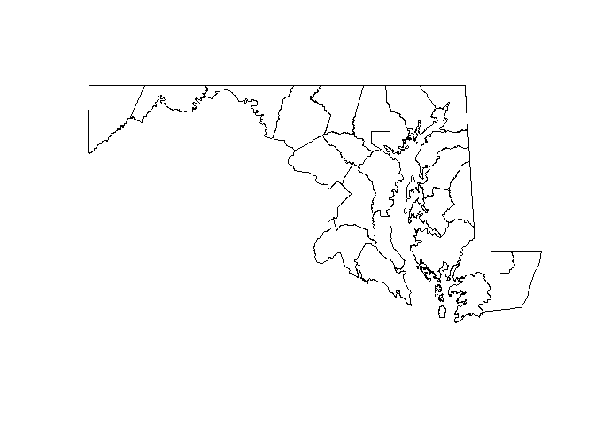
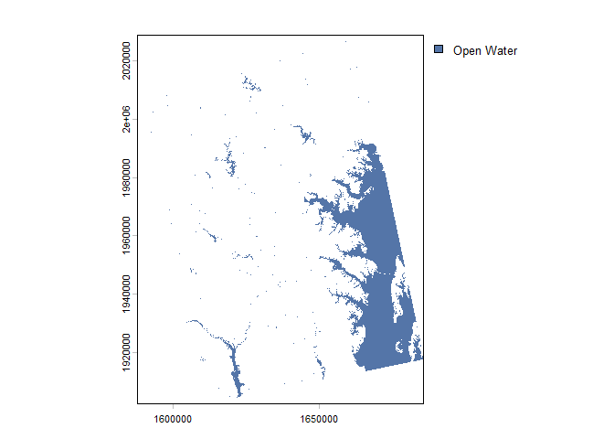
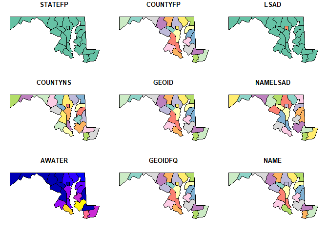

# Setting up for spatial data


Nothing to write or change here! This notebook should confirm that you
have the packages you need to get started working with spatial data. Run
code chunks individually, then render the notebook, either by pressing a
button (if in RStudio), choosing the render command (if in Positron), or
calling the quarto CLI
(`quarto render 12_intro_maps/spatial_setup.qmd`). If this runs
successfully, you should have:

- a map of counties in Maryland
- a map of landcover data
- some data from OpenStreetMap
- (hopefully) a map of a blob in the shape of Maryland

For that last one, it’s not a huge deal if you can’t get `rmapshaper`
installed. It’s a wrapper around a command line tool (also available
[online](https://mapshaper.org/)), but it has some other system
dependencies that we might just not be able to get working. If you can,
great. If not, we can troubleshoot some, and comment that block out if
it really doesn’t work.

``` r
# pkgs <- c(
#     "sf", # sf : spatial data :: dplyr : tabular data
#     "osmdata", # batch download data from OpenStreetMap
#     "terra", # sf-friendly raster tools
#     "tigris", # download shapefiles from the Census Bureau TIGER database
#     "rmapshaper", # command line tool to edit geographies
#     "tidyterra" # dplyr functions + ggplot geoms for terra rasters
# )

# install.packages(pkgs)

# or pak::pkg_install(pkgs) 

# recent update means you should install justviz
# pak::pkg_install("umbc-viz/justviz")

library(ggplot2)
# terra needs to be loaded for some methods to work
library(terra)
```

    terra 1.9.50

This will download a shapefile of Maryland counties from the Census
Bureau’s [TIGER
system](https://www.census.gov/geographies/mapping-files/time-series/geo/tiger-line-file.html),
and make a map.

``` r
counties_sf <- tigris::counties(state = "MD", cb = TRUE)
```

    Retrieving data for the year 2025

``` r
# storage location for TIGER downloads, if one is set
Sys.getenv("TIGRIS_CACHE_DIR") 
```

    [1] ""

``` r
plot(counties_sf[, "geometry"])
```



This will plot raster data from `justviz` (also verifies that you have
the most up-to-date version):

``` r
land <- justviz::load_land_cover()
water <- terra::mask(land, land == "Open Water", maskvalues = FALSE)
plot(water)
```



This will download data from OpenStreetMap, giving a set of `sf` objects
of universities in the area:

``` r
universities <- osmdata::getbb("Maryland", display_name_contains = "United States") |> 
    osmdata::opq() |> 
    osmdata::add_osm_feature(key = "education", value = "university") |>
    osmdata::osmdata_sf()
```

    Waiting 14.999183177948 seconds

``` r
universities
```

    Object of class 'osmdata' with:
                     $bbox : 37.8865288,-79.4873055,39.7230286,-74.9852049
            $overpass_call : The call submitted to the overpass API
                     $meta : metadata including timestamp and version numbers
               $osm_points : 'sf' Simple Features Collection with 4693 points
                $osm_lines : 'sf' Simple Features Collection with 43 linestrings
             $osm_polygons : 'sf' Simple Features Collection with 91 polygons
           $osm_multilines : NULL
        $osm_multipolygons : 'sf' Simple Features Collection with 12 multipolygons

This overly simplifies the boundaries of the state’s counties:

``` r
md_simplified <- rmapshaper::ms_simplify(counties_sf, keep = 0.01)
plot(md_simplified)
```

    Warning: plotting the first 9 out of 12 attributes; use max.plot = 12 to plot
    all


