# Spatial data basics


## Spatial operations

``` r
library(tidyverse)
```

    ── Attaching core tidyverse packages ──────────────────────── tidyverse 2.0.0 ──
    ✔ dplyr     1.2.1     ✔ readr     2.2.0
    ✔ forcats   1.0.1     ✔ stringr   1.6.0
    ✔ ggplot2   4.0.3     ✔ tibble    3.3.1
    ✔ lubridate 1.9.5     ✔ tidyr     1.3.2
    ✔ purrr     1.2.2     
    ── Conflicts ────────────────────────────────────────── tidyverse_conflicts() ──
    ✖ dplyr::filter() masks stats::filter()
    ✖ dplyr::lag()    masks stats::lag()
    ℹ Use the conflicted package (<http://conflicted.r-lib.org/>) to force all conflicts to become errors

``` r
library(sf)
```

    Linking to GEOS 3.14.1, GDAL 3.12.1, PROJ 9.7.1; sf_use_s2() is TRUE

Now that you’re set up for working with spatial data in R, we’ll
practice a few common tasks that, all combined, will get you a nice map.

First, search for an address within Maryland where you want to focus
your map (don’t use anything personal, our lab repos are public!) on
OpenStreetMap’s behind-the-scenes [search
engine](https://nominatim.openstreetmap.org/ui/search.html). Find the
result you want and click “details.” In the table on the next page
you’ll see coordinates for this result; use those to create an `sf`
point object. Its CRS code is 4269.

``` r
# enter the coords inside c() as numbers in the order longitude, latitude
center_coords <- sf::st_point(x = c(-76.50699785012836, 38.9847006352856))
center_web_merc <- sf::st_sfc(center_coords, crs = 4269)
```

Now use `sf::st_transform()` to transform that to a CRS that uses feet
and is focused on Maryland (2248). Verify that it has units “ftUS”:

``` r
center_proj <- sf::st_transform(center_web_merc, crs = 2248)
center_proj
```

    Geometry set for 1 feature 
    Geometry type: POINT
    Dimension:     XY
    Bounding box:  xmin: 1452471 ymin: 480390 xmax: 1452471 ymax: 480390
    Projected CRS: NAD83 / Maryland (ftUS)

    POINT (1452471 480390)

Create a buffer of 5 miles around that center point (1 mile = 5280 feet)
(feel free to change the radius if you want):

``` r
center_buff <- sf::st_buffer(center_proj, dist = 20 * 5280)
center_buff
```

    Geometry set for 1 feature 
    Geometry type: POLYGON
    Dimension:     XY
    Bounding box:  xmin: 1346871 ymin: 374790 xmax: 1558071 ymax: 585990
    Projected CRS: NAD83 / Maryland (ftUS)

    POLYGON ((1558071 480390, 1557926 474863.3, 155...

``` r
# very boring plot
ggplot(center_buff) +
  geom_sf()
```

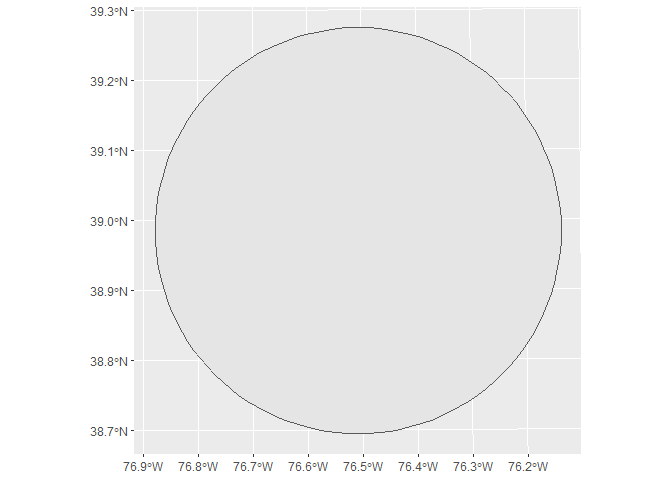

Use `tigris::tracts` to get tracts for all of Maryland
(`justviz::tracts_sf` is a subset, so get a fresh copy). Set the
argument `cb = TRUE` to get simplified boundaries that are better for
mapping, and `progress_bar = FALSE` so your markdown doesn’t get flooded
with lines. Then use the tracts and `dplyr`’s `group_by` and `summarise`
to merge tracts together to form counties.

``` r
tracts_sf <- tigris::tracts(state = "MD", cb = TRUE) |>
  dplyr::select(geoid = GEOID, county = NAMELSADCO, state = STATE_NAME)
```

    Retrieving data for the year 2025

``` r
counties_sf <- tracts_sf |> 
  dplyr::group_by(county) |> 
  dplyr::summarise(.groups = "drop")

  ggplot(counties_sf) +
  geom_sf()
```

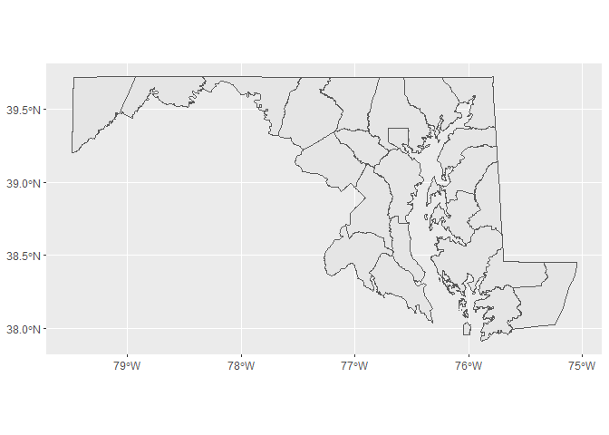

Get the intersection of the buffer and the tract shapes. To do this,
they’ll need to have the same CRS. To find an `sf` object’s CRS, call
`sf::st_crs` on it. If the CRSes are not the same, you’ll have to
reproject one to match the other. Put the tracts on the left side of
your `sf::st_intersection` call so you can retain other info like FIPS
codes.

``` r
sf::st_crs(tracts_sf)
```

    Coordinate Reference System:
      User input: NAD83 
      wkt:
    GEOGCRS["NAD83",
        DATUM["North American Datum 1983",
            ELLIPSOID["GRS 1980",6378137,298.257222101,
                LENGTHUNIT["metre",1]]],
        PRIMEM["Greenwich",0,
            ANGLEUNIT["degree",0.0174532925199433]],
        CS[ellipsoidal,2],
            AXIS["latitude",north,
                ORDER[1],
                ANGLEUNIT["degree",0.0174532925199433]],
            AXIS["longitude",east,
                ORDER[2],
                ANGLEUNIT["degree",0.0174532925199433]],
        ID["EPSG",4269]]

``` r
buff_reproj <- sf::st_transform(center_buff, crs = 4269)
tracts_in_buffer <- sf::st_intersection(tracts_sf, buff_reproj)
```

    Warning: attribute variables are assumed to be spatially constant throughout
    all geometries

``` r
tracts_in_buffer
```

    Simple feature collection with 272 features and 3 fields
    Geometry type: GEOMETRY
    Dimension:     XY
    Bounding box:  xmin: -76.8785 ymin: 38.6955 xmax: -76.13552 ymax: 39.27463
    Geodetic CRS:  NAD83
    First 10 features:
             geoid                 county    state                       geometry
    2  24005420302       Baltimore County Maryland POLYGON ((-76.49472 39.2701...
    3  24033806711 Prince George's County Maryland POLYGON ((-76.86677 38.9802...
    14 24005430400       Baltimore County Maryland POLYGON ((-76.69135 39.2365...
    29 24003730101    Anne Arundel County Maryland POLYGON ((-76.56946 39.1497...
    34 24005420900       Baltimore County Maryland POLYGON ((-76.52699 39.2641...
    39 24003750400    Anne Arundel County Maryland POLYGON ((-76.66206 39.2132...
    46 24003731206    Anne Arundel County Maryland POLYGON ((-76.51189 39.0770...
    47 24510230300         Baltimore city Maryland POLYGON ((-76.62323 39.2600...
    49 24033803528 Prince George's County Maryland POLYGON ((-76.83022 38.9136...
    52 24005420402       Baltimore County Maryland POLYGON ((-76.49964 39.2661...

``` r
ggplot(tracts_in_buffer) +
  geom_sf()
```

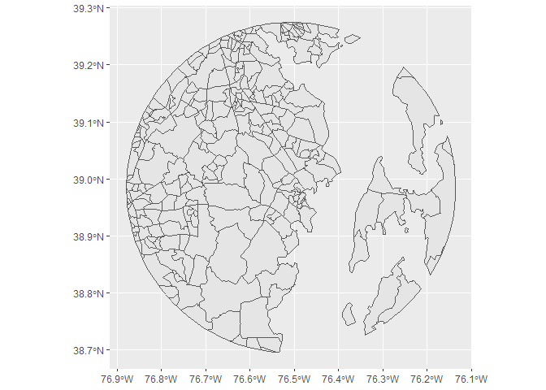

Here’s a confusing step: you already found the *intersection* of the
buffer and another polygon, which creates a new shape. Now you’re going
to find *which shapes intersect*; this doesn’t change the shape, just
returns true/false values. This is a predicate function. If you just
call the predicate function itself, you’ll get a matrix showing whether
each shape on the left (24 counties) intersects at all with the shape on
the right (1 buffer polygon).

``` r
sf::st_intersects(counties_sf, buff_reproj)
```

    Sparse geometry binary predicate list of length 24, where the predicate
    was `intersects'
    first 10 elements:
     1: (empty)
     2: 1
     3: 1
     4: 1
     5: 1
     6: (empty)
     7: (empty)
     8: (empty)
     9: (empty)
     10: (empty)

There are a few ways to do this, but we’ll make a sparse matrix of which
counties intersect with the buffer, then keep the counties that have
values in the matrix. The function `lengths` gives the length of each
element in a vector; in this case, that will give us how many times
shapes from one object intersect shapes from the other object, and we
can filter for anywhere that has 1 or more intersections.

``` r
counties_mask <- sf::st_intersects(counties_sf, buff_reproj)
counties_mask
```

    Sparse geometry binary predicate list of length 24, where the predicate
    was `intersects'
    first 10 elements:
     1: (empty)
     2: 1
     3: 1
     4: 1
     5: 1
     6: (empty)
     7: (empty)
     8: (empty)
     9: (empty)
     10: (empty)

``` r
lengths(counties_mask)
```

     [1] 0 1 1 1 1 0 0 0 0 0 0 0 0 1 1 0 1 1 0 0 1 0 0 0

``` r
nearby_counties <- counties_sf |> dplyr::filter(lengths(counties_mask) > 0)
```

That should give you a subset of counties—in my case, I have 4.

Finally put it all together. Call `ggplot` as usual, but leave it empty
since you’ll have multiple datasets for the different layers. Then add
`geom_sf` calls for `nearby_counties`, `tracts_in_buffer`, and
`center_web_merc`, adjusting whatever you want including any `aes` calls
inside your layers. Give each `geom_sf` call a data frame with
`data = __`.

My ugly example looks like this:

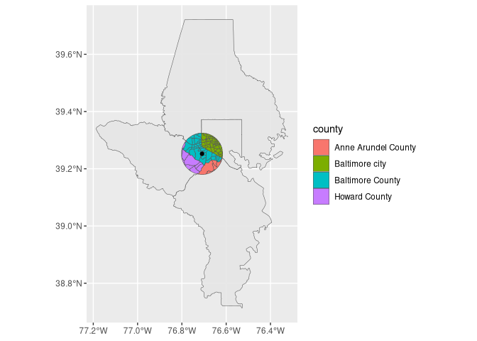

``` r
ggplot() +
  geom_sf(data = nearby_counties) +
  geom_sf(data = tracts_in_buffer, mapping = aes(fill = county)) +
  scale_fill_brewer(palette = "Set3") +
  geom_sf(data = center_web_merc) +
  theme_void()
```

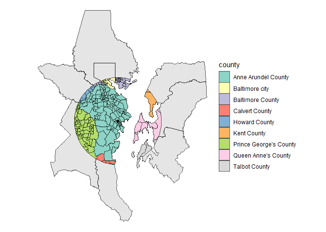

## Layers

We use `geom_sf` a little differently from other geoms, where it’s
common to add up multiple layers with different data frames. Normally
we’d have a data frame in our original `ggplot` call, and its scales and
any aesthetics assigned in that initial call trickle down to the geoms
that follow unless we reassign them (or cancel them out with
`inherit.aes = FALSE`). But because we’ll have different data frames for
each layer, it can be better to leave the `ggplot` call empty and give
each `geom_sf` its own `data` argument.

In the same way that you created `counties_sf` by summarizing tract
geometries by county, create a shape `state_sf` where you summarize all
the tracts into one geometry for the state. You now have 3 geographic
levels (tracts, counties, and state) that can nest within each other
using 3 different layers. Stack the layers and set any aesthetics you
want (linewidth and color are both good) to get a map of Maryland that
shows all 3 layers distinct from one another, i.e. it’s clear which
boundaries are for counties and which are for tracts. Hard-code the
aesthetics in each geom instead of using `aes`.

A hint: `alpha = 0` will get you a geom with borders but no visible
fill, as will `fill = NA` or `fill = "transparent"`.

My example is here. It’s chaotic to highlight the different settings you
can use; make yours look better.

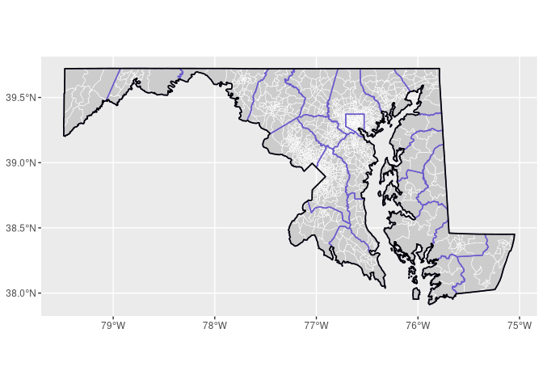

``` r
state_sf <- tracts_sf |> 
  dplyr::group_by(state) |> 
  dplyr::summarise(.groups = "drop")

ggplot() +
  geom_sf(data = tracts_sf, mapping = aes(fill = county), size = 0.2, color = "white") +
  geom_sf(data = counties_sf, fill= NA, size = 1, color = "gray30") +
  geom_sf(data = state_sf, fill = NA, size = 1.5, color = "black") +
  theme(legend.position = "none")
```

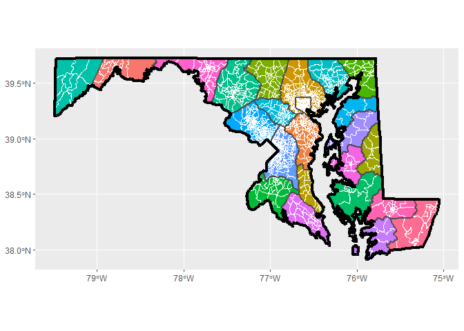

## Legend hacking

Legends in ggplot are normally tough, and with `sf` data they’re even
worse. Normally a geom can take a true/false/NA value for `show.legend`
to determine whether there will be a corresponding legend entry. With
`geom_sf`, this argument can take values for the type of shape to show
as well. This gives us more options and more headaches.

Normally we’d want tidy data with a variable to map onto our aesthetics
(e.g. some group that we assign to color), but since we often have
different spatial data in different data frames, we’ll use separate
`geom_sf` calls and hard-code fake aesthetics to get a legend. For
example, instead of `aes(linewidth = level)` like we would do with a
line chart, `aes(linewidth = "Counties")` will force a legend that shows
a line or polygon key for counties.

There are a lot of different options for changing your legend keys,
including:

- setting a legend type, e.g. `show.legend = "line"` inside `geom_sf`
- turning on & off multiple legend types,
  e.g. `show.legend = c(shape = TRUE, color = FALSE)` inside `geom_sf`
- overriding parts of the legend with a list of options,
  e.g. `guide = guide_legend(override.aes = list(linewidth = 0))` inside
  a scale call
- changing the key type with a `key_glyph` argument inside a geom
  (unfortunately not as well documented as other arguments)

To combine multiple legends into one (e.g. color and linewidth), give
their aesthetics the same name in a call to `labs`.

My example here took 3 calls to `geom_sf`; 3 manual scales, one of which
needed an `override.aes` inside its guide; and a `labs` call to merge
legends.

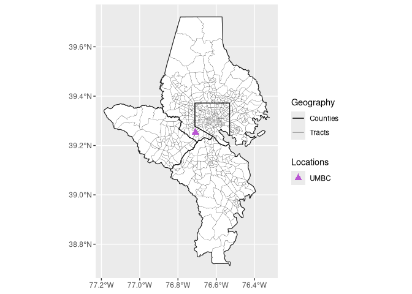

``` r
nearby_tracts <- tracts_sf |>
  dplyr::filter(county %in% nearby_counties$county)

ggplot() +
  geom_sf(data = nearby_tracts)
```

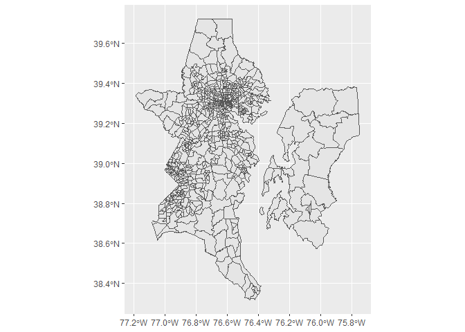

## Joins

### Spatial & nonspatial

To practice joining a spatial data frame and a nonspatial one, you’ll
join `justviz::vacants_by_tract` with your `tracts_sf` in a few ways.
The first of these is a count of vacant building notices per tract
within Baltimore city.

First, do an inner join (`dplyr::inner_join`). You want to end up with
an `sf` data frame with one row per city tract, with only the tracts
that have vacancies and are included in the vacancy data. Remember my
warning about which data frame type needs to be on the left—in order to
use `geom_sf` easily, you need an `sf` data frame.

You should have an `sf` data frame with 182 rows. Once you have that,
make a map of it, just showing the tracts included.

``` r
tracts_with_vacants <- tracts_sf |>
  # join here
  inner_join(justviz::vacants_by_tract, by = 'geoid')
class(tracts_with_vacants)
```

    [1] "sf"         "data.frame"

``` r
ggplot() +
  geom_sf(data = tracts_with_vacants, mapping = aes(fill = n_vacants))
```

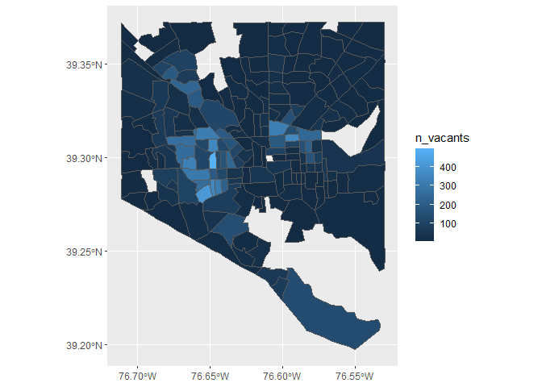

With that map, you only draw tracts that are included in both data
frames, i.e. tracts in Baltimore city that have at least one vacant
notice. Now use a left join so you can keep all tract geometries in the
city, but attach the data about vacancies to it. Filter the tracts data
frame for just Baltimore city, then do your join.

There are 199 tracts in the city, so your result should be an `sf` data
frame with 199 rows. Make a map of this, with tracts filled based on
whether there are any vacancies. Without changing the data, this will be
denoted with the fact that `n_vacants` will be NA for rows not in
`vacants_by_tract`. Replace NAs with 0 using
`tidyr::replace_na(n_vacants, replace = 0)`. Then use `ifelse` to create
a variable `has_vacants` with one value for tracts with n_vacants \> 0
and another value for other tracts (e.g. “Has vacants” / “No vacants”).
Map `has_vacants` to fill, and set a scale that highlights tracts with
vacants.

``` r
balt_sf <- tracts_sf |>
  dplyr::filter(county == "Baltimore city")

balt_tract_vacants_sf <- balt_sf |>
  # join, replace_na, ifelse
  left_join(justviz::vacants_by_tract) |> 
  mutate(n_vacants = replace_na(n_vacants, 0)) |> 
  mutate(has_vacants = ifelse(n_vacants == 0, "No Vacants", "Has Vacants"))
```

    Joining with `by = join_by(geoid)`

``` r
ggplot() +
  geom_sf(data = balt_tract_vacants_sf, mapping = aes(fill = has_vacants))
```

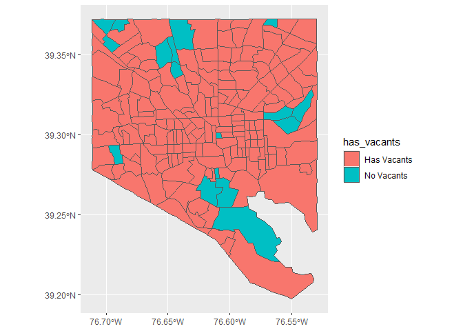

Repeat that, but this time highlight tracts with more than some certain
number of vacants instead of 0. Change the categories you use for
`has_vacants` accordingly (e.g. “50+ vacants” / “\<50 vacants”).

``` r
balt_tract_vacants_sf <- balt_sf |>
  left_join(justviz::vacants_by_tract) |> 
  mutate(n_vacants = replace_na(n_vacants, 0)) |> 
  mutate(has_vacants = ifelse(n_vacants >= 25, "25+ Vacants", "<25 Vacants"))
```

    Joining with `by = join_by(geoid)`

``` r
ggplot() +
  geom_sf(data = balt_tract_vacants_sf, mapping = aes(fill = has_vacants))
```

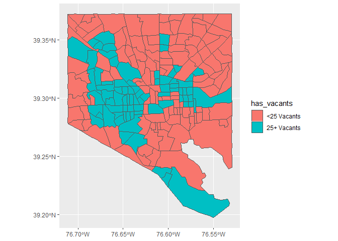

### Spatial & spatial

Last, you’ll do a spatial join, where you join one spatial data frame to
another based on some predicate function. You’re actually doing what I
did to create `justviz::vacants_by_tract`.

Take your Baltimore city tracts, and do a spatial join with
`justviz::vacants_sf` using `sf::st_join`. Make sure to set
`left = FALSE` to do an inner join, so you’re only left with tracts that
contain at least 1 vacant. After the join, you should have an `sf` data
frame with more than 11,000 rows, one per vacant building. Each vacant
will now have a tract associated with it. At this point, you don’t need
the geometries, so drop them with `sf::st_drop_geometry`. Then call
`dplyr::count` grouping by GEOID to get a count of vacant buildings in
each tract. This should have the same number of rows as
`justviz::vacants_by_tract`.

``` r
my_vacants_by_tract <- balt_sf |>
  # join, drop, count
  st_join(justviz::vacants_sf, left = FALSE) |> 
  st_drop_geometry()

my_vacants_by_tract |> 
  group_by(geoid) |> 
  count()
```

    # A tibble: 182 × 2
    # Groups:   geoid [182]
       geoid           n
       <chr>       <int>
     1 24510010100     5
     2 24510010200     5
     3 24510010300     2
     4 24510010400     3
     5 24510010500     2
     6 24510020100     2
     7 24510020200     7
     8 24510020300    14
     9 24510030100    19
    10 24510030200    11
    # ℹ 172 more rows

``` r
count(justviz::vacants_by_tract)
```

    # A tibble: 1 × 1
          n
      <int>
    1   182
